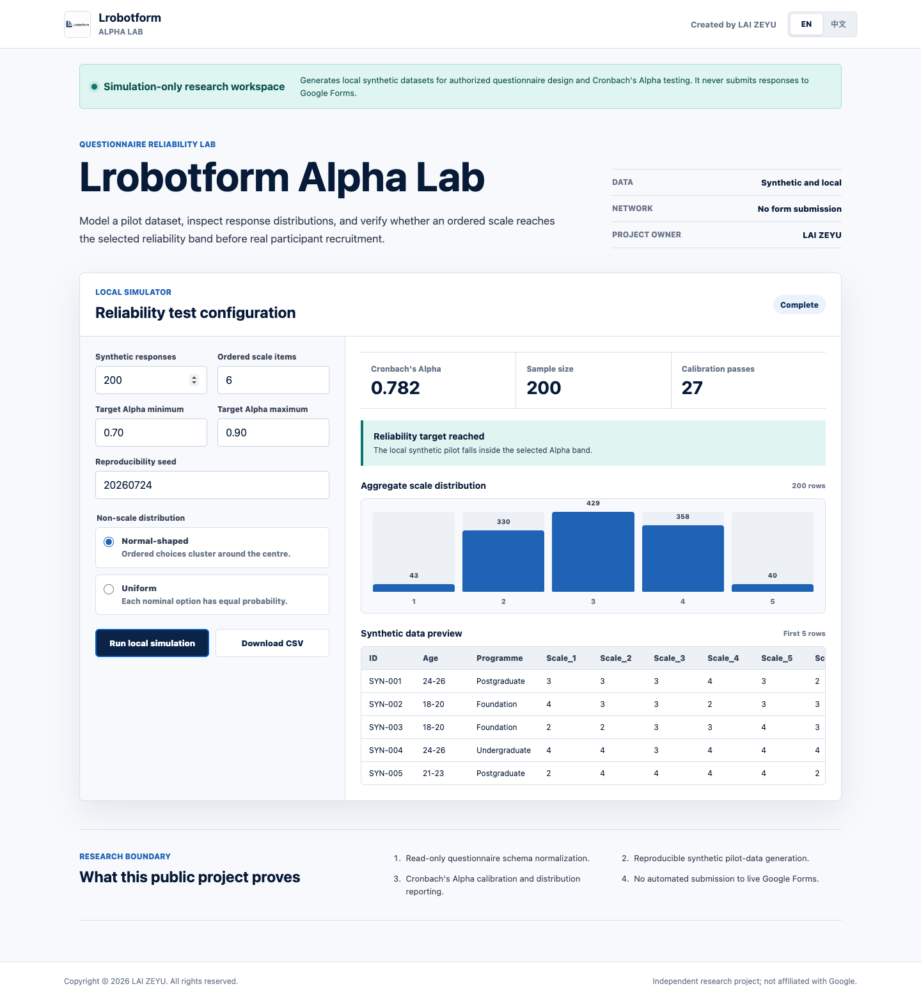

# Lrobotform Alpha Lab

> Created and owned by **LAI ZEYU**
>
> Copyright (c) 2026 LAI ZEYU. Released under the MIT License.

Lrobotform Alpha Lab is a bilingual, local-first questionnaire reliability
workspace for **authorized research and instrument design**. It converts a
read-only questionnaire blueprint into a reproducible synthetic pilot dataset,
calculates Cronbach's Alpha for ordered scale items, reports distributions, and
exports CSV and JSON artifacts for analysis.

This project is **not a response-inflation bot**. The public repository contains
no code that posts answers to Google Forms, imitates human participants, or
bypasses platform controls.



## Research Purpose

The intended workflow is:

1. A researcher exports the structure of a Google Form they own or are
   authorized to test.
2. The toolkit normalizes supported question types into a local schema.
3. A seeded simulation generates clearly labelled synthetic pilot data.
4. Ordered scale items are calibrated against a selected Cronbach's Alpha band.
5. The researcher reviews item distributions and exports a local dataset and
   reliability report.
6. Real participant responses remain a separate, consent-based collection
   process.

The default target band is `0.70-0.90`. A target is a design-test parameter, not
evidence that a questionnaire is valid, unbiased, representative, or ready for
publication.

## What I Designed

LAI ZEYU defined the product scope, research boundary, reliability workflow,
data-generation rules, privacy requirements, interface direction, and final
acceptance criteria. Implementation was developed under LAI ZEYU's direction
with AI-assisted engineering tools.

The public portfolio demonstrates:

- read-only Google Forms schema export through Apps Script;
- normalization of scale, grid, choice, checkbox, and text question types;
- deterministic synthetic data from a reproducibility seed;
- Cronbach's Alpha calculation and target-band calibration;
- distribution summaries and complete CSV/JSON output;
- a bilingual browser simulator that runs entirely on the user's device;
- automated tests that prohibit live form-submission code.

## Quick Start

Python 3.9 or later is required.

```bash
python3 -m venv .venv
source .venv/bin/activate
python3 -m pip install --upgrade pip
python3 -m pip install -e .
python3 -m unittest discover -s tests -v
```

For a complete clean-clone check, run:

```bash
./scripts/verify.sh
```

This installs the package in an isolated environment, runs every safety and
reliability test, generates a deterministic sample, and checks the static web
demo. See [docs/REPRODUCIBILITY.md](docs/REPRODUCIBILITY.md) for expected
artifacts and verification boundaries.

Generate a local synthetic pilot:

```bash
lrobotform-alpha examples/questionnaire.json \
  --responses 200 \
  --target-min 0.70 \
  --target-max 0.90
```

The command creates:

- `output/synthetic_responses.csv`
- `output/alpha_report.json`

Both outputs explicitly identify the rows as synthetic.
The CSV includes `synthetic_record_id`, `data_origin`, and `simulation_seed`
provenance columns so exported rows cannot be mistaken for participant data.

## Google Forms Blueprint

The file
[`adapters/google_forms_schema_exporter.gs`](adapters/google_forms_schema_exporter.gs)
is a read-only Apps Script helper. Run it only inside a Google Form you own or
have written authorization to test. It logs the question blueprint as JSON and
does not read or submit responses.

Use the exported JSON with:

```bash
lrobotform-alpha blueprint.json --google-blueprint --responses 200
```

## Browser Demo

The static demo is in [`web/`](web/). It performs all calculations locally and
does not send data to a server.

```bash
python3 -m http.server 8080 --directory web
```

Then open `http://127.0.0.1:8080`.

## Repository Layout

```text
src/lrobotform_alpha/   Simulation, schema mapping, Alpha, and reporting
adapters/               Read-only Google Forms schema exporter
examples/               Synthetic example questionnaire
tests/                  Reliability, completeness, and safety tests
web/                    Bilingual local simulator
docs/                   Architecture and research-method documentation
.github/                Ownership and automated validation
```

## Research And Safety Boundary

- Use only questionnaires you own or are explicitly authorized to test.
- Never present synthetic rows as real participant data.
- Do not use Alpha alone as proof of validity or research quality.
- Keep production forms, credentials, participant data, and consent records out
  of this repository.
- The public implementation intentionally excludes all automated submission,
  order, payment, customer, and production-server code.

See [ETHICAL_USE.md](ETHICAL_USE.md), [SECURITY.md](SECURITY.md), and
[docs/research-method.md](docs/research-method.md).

## Ownership

Repository metadata, commit authorship, package metadata, CODEOWNERS,
`CITATION.cff`, the MIT copyright notice, and the visible interface identify
**LAI ZEYU** as the project owner and creator. See
[PROJECT_OWNERSHIP.md](PROJECT_OWNERSHIP.md).

The source code is available under the [MIT License](LICENSE), which permits
independent reproduction while retaining the copyright and attribution notice.
The Lrobotform name and any third-party trademarks are not transferred by the
software licence.
