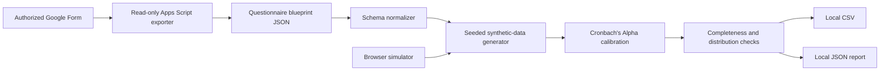

# Architecture

## Trust Boundary

The public system ends at local artifacts. It does not contain an HTTP client,
browser runner, or POST adapter for live Google Forms.

## Determinism

Each run uses an explicit integer seed. The same questionnaire, parameters, and
seed produce the same synthetic dataset and Alpha result. This supports
repeatable demonstrations and test comparisons.

## Reliability Calibration

The generator models a shared latent trait with item-specific noise, maps the
continuous values onto ordered response options, calculates Cronbach's Alpha,
and searches for the closest candidate inside the requested range.

Non-scale choices are generated independently. Ordered choices may use a
normal-shaped distribution; nominal choices use equal or declared custom
weights. Every exported cell is generated locally and labelled as synthetic.
